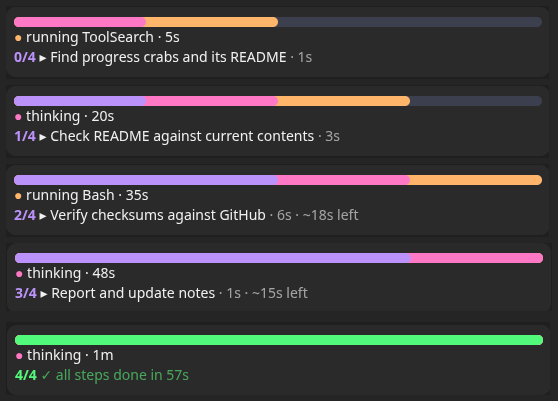

# ProgressCrabs

A Claude Code mod for long chats: a live progress band above the prompt and a panel of side sessions drawn as little crabs. Dracula by default, with ten more themes.




## What it shows

- **Progress bar**: the chat's task list as a full-width pill. In Dracula: purple = done, pink = in progress, orange = up next, slate = the rest.
- **Working row**: what Claude is doing right now and for how long: `thinking · 42s`, `running Bash · 1m`, `writing · 2m`. Shows in any chat, task list or not.
- **Steps and time**: `done/total`, the current step, how long it has run and `~Nm left` from the finished steps (the latest weigh most; shown once two have finished and their times agree). A finished list flashes once, then turns green with its total time. A turn stopped mid-step marks it `⏸ interrupted` until the next update. In a short or narrow window it folds into one row.
- **Crab Tasks pane**: `details ↗` on the band or `/progress list` opens a **Crab Tasks** tab with one bar per step. The running step cools like hot metal (orange edge through pink to purple) as it fills against the usual step's time, pulses when it runs long, and flashes green when it finishes.
- **Side sessions**: each session started from this chat, by title, with its state.
- **Crab panel**: one card per side session, and in a side session one for the chat that started it (marked `↑` when the app's list makes it certain, read every 10 seconds while any session works, every minute when all are idle). Idle times count from the session's last activity; archived sessions drop off. Sessions that need you sit at the top. The crab walks while it works, raises its claws with a `?` when it waits on you, shows a check when done. A toast pops when one finishes a turn or starts waiting; `Open ↗` switches to it.

Works on the desktop app (drawn as SVG) and in the terminal (block characters). Animation stops under reduced-motion settings. After a restart or resume the task list is rebuilt from the chat's transcript.

## Install

```
/plugin install progress-crabs --marketplace gkuba/ProgressCrabs
```

Or in two steps:

```
/plugin marketplace add gkuba/ProgressCrabs
/plugin install progress-crabs@progress-crabs
```

Or from a clone:

```bash
claude plugin marketplace add ~/Projects/ProgressCrabs
claude plugin install progress-crabs@progress-crabs
```

## Use

- `/progress` hides or shows the band for the session; `/progress show` and `/progress hide` set it either way; `/progress list` opens or closes the Crab Tasks pane; `/progress clear` drops a task list left behind (one not updated for 3 turns draws dimmed). Anything else prints the usage.
- `/progress theme [name]` lists or switches colour themes (see Themes).
- `/crabs` shows or hides the side sessions panel (it opens by itself the first time a side session appears; once you close it, it stays closed until `/crabs`).
- The panel reads the app's session list in the background, but never puts a permission dialog up by itself. If your permission mode would ask, the panel shows an **Allow session tools** button; press it (or run `/crabs`) and answer "always allow" to keep it current. Until then it uses the app's note.
- Turn it off: `claude plugin disable progress-crabs@progress-crabs`. Remove it: `claude plugin uninstall progress-crabs@progress-crabs`.

## Themes

`dracula` (default), `tokyo-night`, `nord`, `github`, `github-light`, `gruvbox`, `one-dark`, `catppuccin-latte`, `catppuccin-frappe`, `catppuccin-macchiato`, `catppuccin-mocha`.

- `/progress theme` lists them, marks the current one and opens a **Themes** panel with each theme's colours; click one to switch.
- `/progress theme <name>` switches straight away. The choice is saved and carries into new chats.
- `/progress theme default` goes back to the theme in your settings.

### Settings

Set a **Theme** and four optional hex colours laid over it, **Done**, **Current**, **Next** and **Crab** (leave one blank to keep the theme's colour), in `/config`, on the install screen, or with:

```
/plugin configure progress-crabs@progress-crabs
```

From a shell, `claude plugin configure progress-crabs@progress-crabs` shows what is set, and this sets values:

```bash
echo '{"theme":"nord","done_color":"#88c0d0","crab_color":"#d08770"}' | claude plugin configure progress-crabs@progress-crabs --values-stdin
```

They are stored in `~/.claude/settings.json` under `pluginConfigs`.

A theme picked with `/progress theme` wins over the settings' theme until you change the settings' theme, which then takes over; the hex colours apply on top of either.

### Edit or add a theme

The palettes are in [`plugins/progress-crabs/hooks/themes.ts`](plugins/progress-crabs/hooks/themes.ts), one entry per theme; the comment at the top says which part of the band each colour paints. In a clone installed as a local marketplace (see Install), edit that file or add an entry, then run `/reload-plugins` or start a new chat. A new entry shows up in `/progress theme` at once; add its name to the `theme` options in `plugins/progress-crabs/.claude-plugin/plugin.json` to put it in the settings picker too.

## Notes

The task list and side sessions come from the Claude desktop app's task-list and linked-session tools; in a plain terminal session the band shows the working row only.

## Develop

The mod lives in [`plugins/progress-crabs`](plugins/progress-crabs). Check and test it with:

```bash
claude plugin validate plugins/progress-crabs
claude plugin test plugins/progress-crabs
```

A clone installed as a local marketplace is read live: edits load in new sessions.

## Credits

The crab animation approach (a CSS-animated sprite inside an SVG) follows [savvy-progress](https://github.com/johnnyvizz/claude-kit) (MIT). The sprite and code here are this project's own.

## License

MIT, see [LICENSE](LICENSE).
