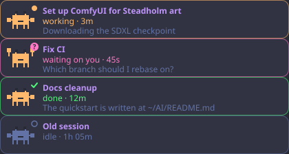

# ProgressCrabs

A Claude Code mod for long chats: a live progress band above the prompt and a panel of side sessions drawn as little Dracula-coloured crabs.



## What it shows

- **Progress bar**: the chat's task list as a full-width pill. Purple = done, pink = in progress, orange = up next, slate = the rest.
- **Working row**: what Claude is doing right now and for how long: `thinking · 42s`, `running Bash · 1m`, `writing · 2m`. Shows in any chat, task list or not.
- **Steps and time**: `done/total`, the current step, how long it has run and `~Nm left (rough)` from the average finished step.
- **Side sessions**: each session started from this chat, by title, with its state.
- **Crab panel**: one card per side session. The crab walks while it works, raises its claws with a `?` when it waits on you, shows a check when done. A toast pops when one finishes a turn or starts waiting; `Open ↗` switches to it.

Works on the desktop app (drawn as SVG) and in the terminal (block characters). Animation stops under reduced-motion settings.

## Install

```
/plugin marketplace add gkuba/ProgressCrabs
/plugin install progress-crabs@progress-crabs
```

Or from a clone:

```bash
claude plugin marketplace add ~/Projects/ProgressCrabs
claude plugin install progress-crabs@progress-crabs
```

## Use

- `/progress` hides or shows the band for the session.
- `/crabs` shows or hides the side sessions panel (it opens by itself the first time a side session appears).
- Turn it off: `claude plugin disable progress-crabs@progress-crabs`. Remove it: `claude plugin uninstall progress-crabs@progress-crabs`.

The task list and side sessions come from the Claude desktop app's task-list and linked-session tools; in a plain terminal session the band shows the working row only.

## Develop

The mod lives in [`plugins/progress-crabs`](plugins/progress-crabs). Check and test it with:

```bash
claude plugin validate plugins/progress-crabs
claude plugin test plugins/progress-crabs
```

A clone installed as a local marketplace is read live: edits load in new sessions.

## Credits

The crab animation approach (a CSS-animated sprite inside an SVG) follows [savvy-progress](https://github.com/johnnyvizz/claude-kit) (MIT). The sprite and code here are this project's own.

## License

MIT, see [LICENSE](LICENSE).
